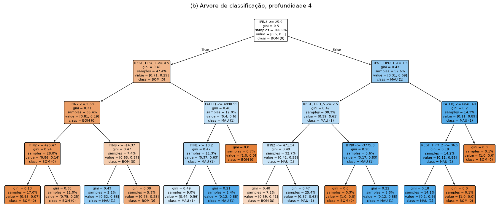
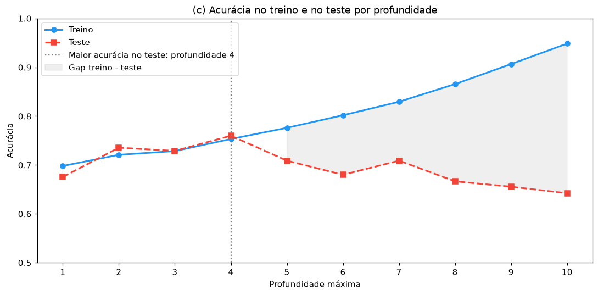
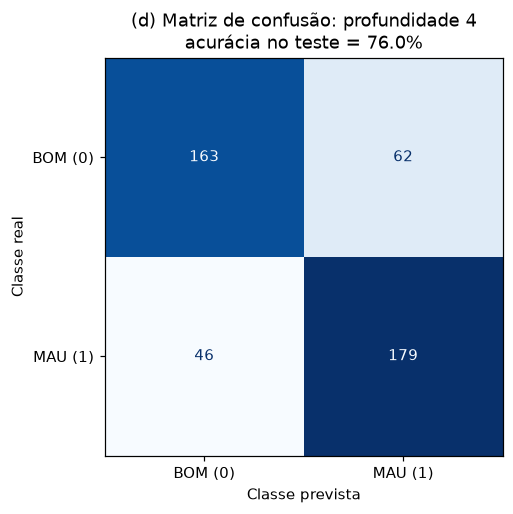
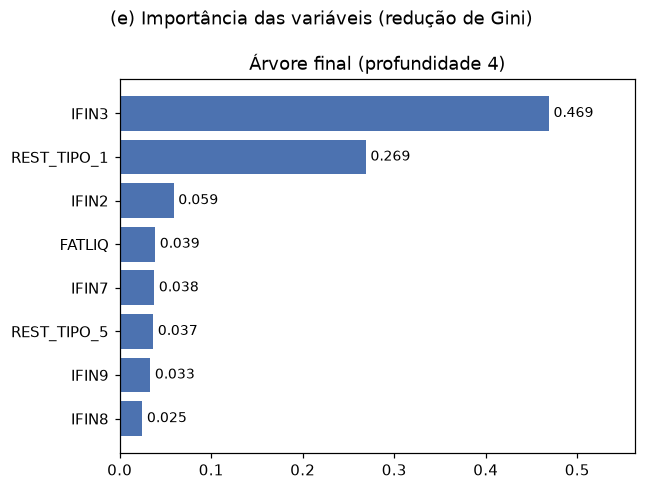
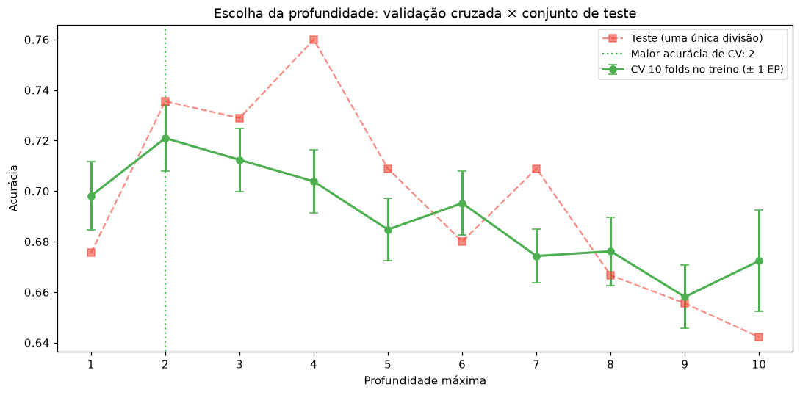
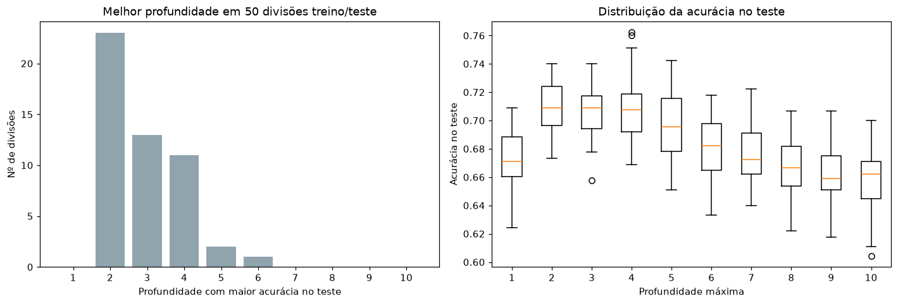
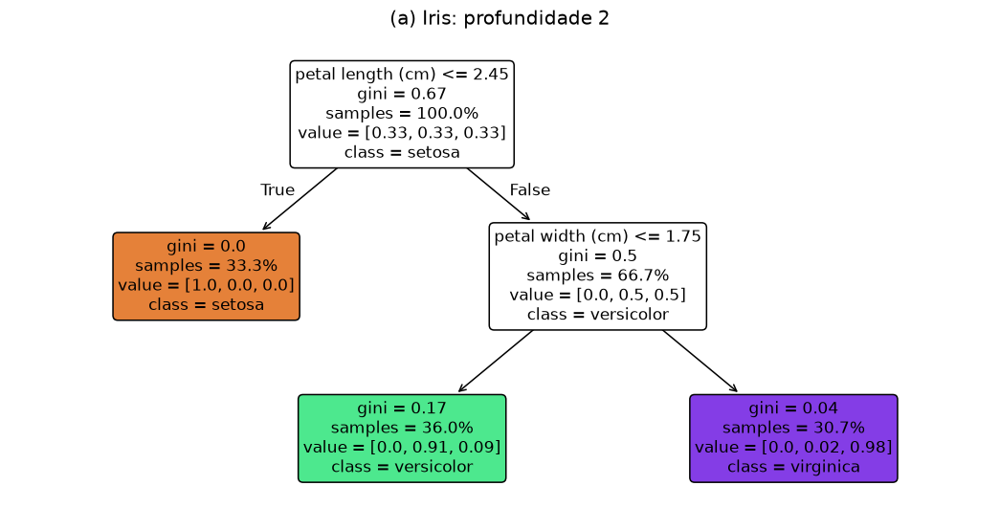
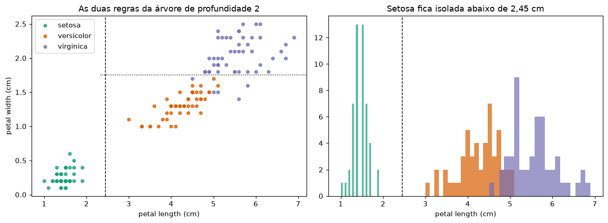

# Árvores de Decisão: Inadimplência de Empresas e Iris

Duas aplicações de árvores de classificação. A principal é um modelo de risco de crédito que prevê a inadimplência de 1.500 empresas a partir de indicadores financeiros, restrições cadastrais e dados da empresa. A segunda usa a base Iris para mostrar, de forma visual, como uma árvore escolhe suas perguntas.

## Principais resultados

- **Duas variáveis concentram a maior parte do poder preditivo:** o indicador financeiro `IFIN3` e a quantidade de desabonos do cliente nos últimos 6 meses (`REST_TIPO_1`). Empresas com `IFIN3` baixo e nenhum desabono têm 19% de inadimplência; com `IFIN3` alto e dois ou mais desabonos, 89%.
- **A árvore de profundidade 4 teve a maior acurácia no teste (76,0%),** mas a validação cruzada no treino aponta profundidade 2 (73,6% no teste). Em 50 divisões treino/teste diferentes, as profundidades 2, 3 e 4 empatam em ~71%, e a partir da 5 o desempenho cai.
- **O modelo erra mais recusando bons clientes (62) do que aprovando maus (46).** Como aprovar um mau pagador costuma custar bem mais, baixar o ponto de corte reduz os maus aprovados de 46 para 16 e o custo total em 20%, considerando um custo de 5 para 1.

## Estrutura do projeto

```
arvores-decisao/
├── data/
│   └── base_pejota.xls            
├── src/
│   ├── config.py                  # caminhos, semente, profundidades, custos dos erros
│   ├── data.py                    # passos 1 a 4 do pré-processamento e divisão treino/teste
│   ├── preprocessing.py           # passo 5: Pipeline com mediana do treino + one-hot de UF
│   ├── q1_inadimplencia.py        # Parte 1, itens (a) a (e)
│   ├── q1_complementos.py         # validação cruzada, 50 divisões, custo dos erros
│   ├── q2_iris.py                 # Parte 2 (Iris)
│   └── utils.py                   # salvar tabelas e figuras
├── tests/
│   └── test_preprocessing.py      
├── results/
│   ├── figures/                   # gráficos usados neste README
│   └── tables/                    
├── main.py
├── requirements.txt
└── README.md
```

O pré-processamento está dividido em dois arquivos. `data.py` faz os passos que não dependem da divisão treino/teste: ler a aba, limpar nomes e brancos e criar `DEFAULT`. `preprocessing.py` faz o passo 5 dentro de um `Pipeline` do scikit-learn. Assim, a mediana usada na imputação e as categorias de `UF` são aprendidas só com o treino. Na validação cruzada, são aprendidas só com os folds de treino.

Cada módulo de questão imprime as respostas no terminal e salva tabelas e figuras em `results/`. O `main.py` apenas chama os módulos em ordem.

---

## Parte 1: modelo de inadimplência

### (a) Pré-processamento

A base tem **1.500 empresas**, com **50% de inadimplentes**. As classes são exatamente balanceadas (750 BOM e 750 MAU), então a acurácia de referência de um modelo que chuta sempre a mesma classe é 50%.

Colunas com valores ausentes antes da imputação:

| Coluna | Ausentes | % |
|---|---|---|
| IFIN1 | 99 | 6,6 |
| IFIN2 | 98 | 6,5 |
| IFIN4 | 30 | 2,0 |
| IFIN5 | 102 | 6,8 |
| IFIN7 | 40 | 2,7 |
| IFIN8 | 122 | 8,1 |
| IDADE | 3 | 0,2 |

### (b) Árvore de profundidade 4

A divisão é 70% treino (1.050) e 30% teste (450), estratificada por `DEFAULT`. São 21 preditores: as 19 variáveis originais, exceto `COD_CLI` e `STATUS`, com `UF` codificada em `UF_RJ` e `UF_SP`.



| Nó | Empresas no treino | % inadimplentes |
|---|---|---|
| Todas | 1.050 | 50,0% |
| `IFIN3` ≤ 25,9 | 498 | 29,1% |
| ↳ e nenhum desabono (`REST_TIPO_1` = 0) | 372 | 18,8% |
| ↳ e 1 ou mais desabonos | 126 | 59,5% |
| `IFIN3` > 25,9 | 552 | 68,8% |
| ↳ e até 1 desabono | 402 | 61,4% |
| ↳ e 2 ou mais desabonos | 150 | 88,7% |

**O que as primeiras divisões revelam:**

- A primeira pergunta é sobre o indicador financeiro `IFIN3`, que sozinho separa um grupo de risco baixo (29%) de um de risco alto (69%).
- A segunda pergunta, nos dois lados, é sobre `REST_TIPO_1`, a quantidade de desabonos do cliente. As duas informações se somam: o risco vai de 19% a 89% combinando as duas.
- O limiar de `REST_TIPO_1` muda conforme o ramo. Para empresas com `IFIN3` baixo, um único desabono já eleva o risco. Para as de `IFIN3` alto, que já são arriscadas, o que pesa é ter dois ou mais.

Nos níveis mais profundos aparecem folhas com 1 a 3 empresas, por exemplo `REST_TIPO_2` > 36,5.

### (c) Acurácia por profundidade



| Profundidade | Treino | Teste | Gap |
|---|---|---|---|
| 1 | 69,8% | 67,6% | 2,3 |
| 2 | 72,1% | 73,6% | −1,5 |
| 3 | 72,9% | 72,9% | 0,0 |
| **4** | 75,3% | **76,0%** | −0,7 |
| 5 | 77,6% | 70,9% | 6,7 |
| 6 | 80,2% | 68,0% | 12,2 |
| 8 | 86,6% | 66,7% | 19,9 |
| 10 | 94,9% | 64,2% | 30,6 |

**O overfitting começa na profundidade 5.** No gráfico, ele aparece como a abertura entre as duas curvas. A acurácia no treino continua subindo de forma constante, até quase 95%, enquanto a do teste para de acompanhar e cai. Até a profundidade 4, treino e teste andam juntos. Da 5 em diante, cada nível a mais melhora o treino e piora o teste, e o gap passa de 6,7 pontos (profundidade 5) para mais de 30 (profundidade 10).

### (d) Matriz de confusão

A maior acurácia no teste é da **profundidade 4**: **76,0%**.



| | Previsto BOM | Previsto MAU |
|---|---|---|
| **Real BOM** | 163 | 62 |
| **Real MAU** | 46 | 179 |

**O modelo erra mais classificando bons clientes como maus** (62 falsos positivos) do que maus como bons (46 falsos negativos). Ele detecta 79,6% dos inadimplentes e aprova 72,4% dos adimplentes.

**O erro mais custoso é aprovar um mau pagador** (falso negativo). Recusar um bom cliente custa a margem que a empresa deixaria de ganhar naquela operação. Aprovar um inadimplente pode custar o valor emprestado inteiro, além dos custos de cobrança. Em crédito, é comum que essa perda seja várias vezes maior que a margem, e por isso a acurácia sozinha não é o critério certo para escolher o modelo. A análise complementar 3 mostra como ajustar o ponto de corte para levar isso em conta.

### (e) Variáveis mais importantes



| Variável | Importância |
|---|---|
| `IFIN3` | 0,469 |
| `REST_TIPO_1` | 0,269 |
| `IFIN2` | 0,059 |
| `FATLIQ` | 0,039 |
| `IFIN7` | 0,038 |

As duas primeiras somam 74% da importância total. Entre os indicadores financeiros, aparecem `IFIN3`, `IFIN2`, `FATLIQ` e `IFIN7`. Entre as restrições, `REST_TIPO_1`. `REST_TIPO_5` (desabonos dos sócios) vem logo depois, em 6º lugar.

- **`REST_TIPO_1` (desabonos do cliente nos últimos 6 meses)** é a variável mais fácil de interpretar. A inadimplência cresce de forma clara com o número de desabonos: 38% sem nenhum, 58% com um, 78% com dois e 85% com três ou mais. Desabonos (protestos, cheques devolvidos, atrasos registrados) são o histórico recente de pagamento da empresa, que é o melhor indicador de como ela vai pagar a próxima dívida.
- **`IFIN3`** é o indicador de balanço mais discriminante. Empresas acima de 25,9 têm 69% de inadimplência, contra 30% das que estão abaixo. O dicionário da base não informa o que cada `IFIN` mede, só que vêm do último balanço publicado. Pelo comportamento (valores maiores, mais risco, e cerca de um quarto das empresas com valor zero), ele se parece com um indicador de endividamento ou de comprometimento financeiro, mas essa leitura é uma hipótese.
- **`FATLIQ` (faturamento líquido)** aparece nos ramos de maior risco, separando empresas grandes, que são mais seguras. No quartil de maior faturamento, a inadimplência é de 42%, contra 54% no menor. Empresas maiores tendem a ter receita mais estável e mais acesso a crédito para rolar dívidas.

### (f) Interpretação conceitual

O fenômeno se chama **overfitting** (sobreajuste). Uma árvore muito profunda consegue criar uma regra para quase cada observação do treino, até folhas com uma única empresa. Ela passa a memorizar o ruído e as particularidades daquela amostra em vez do padrão geral. No treino isso parece ótimo, porque a acurácia se aproxima de 100%, mas essas regras não se repetem em dados novos. Em termos de viés e variância, a árvore profunda tem viés baixo e variância alta: mudar poucas observações do treino muda bastante a árvore.

O experimento do item (c) torna isso visível. Enquanto as curvas de treino e teste sobem juntas, a árvore está aprendendo padrões reais. Quando elas se separam, está aprendendo ruído. A profundidade adequada fica na região antes da separação, onde o erro fora da amostra é mínimo. Aqui, entre 2 e 4.

Há uma ressalva importante: se o conjunto de teste é usado para escolher a profundidade, ele deixa de ser uma avaliação independente. A forma mais correta é escolher por validação cruzada no treino e usar o teste só no final. É o que faz a análise complementar 1.

---

## Análises complementares

### 1. Escolha da profundidade por validação cruzada



Com validação cruzada estratificada de 10 folds, usando só o treino, a melhor profundidade é **2**, com 72,1% ± 1,3%. As profundidades 3 e 4 ficam dentro de um erro padrão (71,2% e 70,4%). A árvore de profundidade 2 tem 73,6% no teste.

Os 76,0% da profundidade 4 no item (d) são, em parte, sorte da divisão. Ao escolher o maior valor entre 10 resultados no mesmo teste, a estimativa fica otimista. A árvore de profundidade 2 tem só 4 folhas e usa só `IFIN3` e `REST_TIPO_1`, o que a torna mais simples de explicar e de aplicar.

### 2. A melhor profundidade muda com a divisão



Repetindo a divisão treino/teste com 50 sementes, a profundidade de maior acurácia no teste foi 2 em 23 casos, 3 em 13 e 4 em 11. Na média, as três empatam (71,0%, 70,7% e 70,8%), e a partir da 5 a acurácia cai de forma consistente. A conclusão do item (c) é robusta, mas a escolha exata entre 2, 3 e 4 é ruído.

### 3. Ponto de corte considerando o custo dos erros

Por padrão, a árvore classifica como MAU quando a proporção de maus na folha passa de 50%. Se aprovar um mau pagador custa 5 vezes mais que recusar um bom, o corte que minimiza o custo esperado é 1/(1+5) ≈ 0,17. Usando a árvore do item (d):

| Corte | Bons recusados | Maus aprovados | Acurácia | Custo (FP + 5·FN) |
|---|---|---|---|---|
| 0,50 (padrão) | 62 | 46 | 76,0% | 292 |
| 0,40 | 88 | 33 | 73,1% | 253 |
| 0,17 | 155 | 16 | 62,0% | **235** |

O corte mais baixo reduz os maus aprovados de 46 para 16 e o custo total em 20%, embora a acurácia caia 14 pontos. A razão de 5 para 1 é um exemplo. Na prática, ela viria da margem e da taxa de recuperação da empresa, e o corte poderia ser ajustado com essa informação.

---

## Parte 2: entendendo a árvore visualmente (Iris)

### (a) Profundidade 2



A árvore faz duas perguntas:

1. **`petal length` ≤ 2,45 cm?** Se sim, é *setosa*.
2. **`petal width` ≤ 1,75 cm?** Se sim, é *versicolor*; se não, *virginica*.



### (b) Profundidade 1

Com `random_state=42`, a árvore escolhe **`petal length` ≤ 2,45**. Faz sentido porque essa regra separa *setosa* perfeitamente. Todas as setosas têm pétala de até 1,9 cm, e todas as outras flores têm pelo menos 3,0 cm. Uma única pergunta já classifica corretamente um terço das flores.

Há um detalhe: **`petal width` ≤ 0,8 também separa *setosa* perfeitamente** (máximo de 0,6 nas setosas, mínimo de 1,0 nas demais), com exatamente o mesmo ganho de Gini. As duas regras empatam, e o scikit-learn desempata pela ordem aleatória em que testa as variáveis. Em 20 valores de `random_state`, a raiz foi `petal width` em 15 e `petal length` em 5. A resposta "petal length" está certa para a semente usada, e a interpretação é a mesma nos dois casos: as medidas da pétala separam *setosa* das outras espécies.

### (c) Acurácia no conjunto completo

A acurácia da árvore de profundidade 2 nos próprios dados de treino é **96,0%**. Ela **não** é um bom estimador do desempenho em dados novos, porque o modelo está sendo avaliado nos mesmos exemplos que usou para escolher suas regras.

O quanto ela é otimista depende da complexidade do modelo:

| Modelo | Acurácia nos próprios dados | Acurácia CV 10 folds | Otimismo |
|---|---|---|---|
| Profundidade 2 | 96,0% | 92,0% | 4,0 p.p. |
| Sem limite | 100,0% | 93,3% | 6,7 p.p. |

A árvore sem limite de profundidade tem 100% nos dados de treino, por construção, mas isso não significa que ela seja perfeita. Para estimar o desempenho real, é preciso validação cruzada ou um conjunto de teste separado.

---

## Ferramentas

Python, scikit-learn, pandas, NumPy, Matplotlib, xlrd e pytest.
